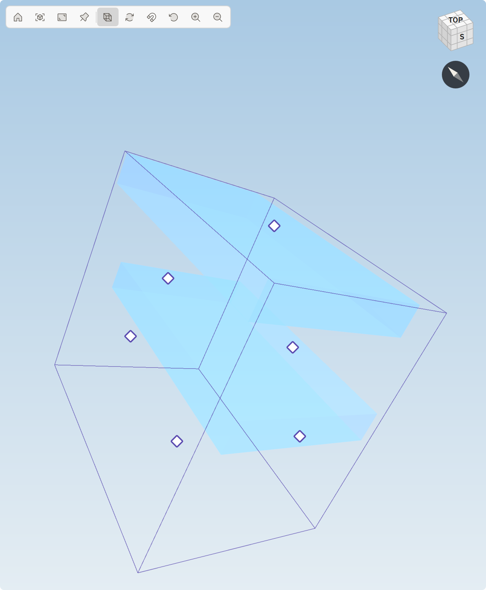

<h1 align="center">
  
  Prisma
</h1>

  Open IFC models together, inspect their objects and cut sections through the scene.

  <a href="#explore-a-model">Explore a model</a> ·
  <a href="#section-box">Section box</a> ·
  <a href="#development-status">Development status</a> ·
  <a href="CONTRIBUTING.md">Contributing</a> ·
  <a href="LICENSE">Licence</a>

Prisma is being developed as a desktop viewer for **Industry Foundation Classes (IFC)** models on Windows and Linux. In the prototype, you can open a building and a second discipline’s model in the same view, then use a section box to look inside. The source IFC files stay unchanged as you move the camera or adjust a cut.

## Explore a model

- **Open several models.** Add a second IFC file to the scene while keeping the first in view. Each object retains its association with its source model.
- **Inspect an object.** Select a wall or slab to look up its IFC class, name and GlobalId. Where the file provides them, you can also inspect property sets and quantities in the model’s own units.
- **Navigate in 3D.** Use the view cube to switch orientation or fit the models back into the window after a close inspection.

## Section box

Drag a face of the box to move the cut through the model. For a building that runs at an angle, rotate the box or align it to a face in the model. You can then move the cut along that direction.

  

The Linux prototype displaying a synthetic IFC4 model. The diamonds are the handles for adjusting the box.

## Local tools

The prototype supports the **Model Context Protocol (MCP)**. A local client can list objects and inspect their properties in the IFC files you select at startup. With view control enabled, it can also fit the scene into the window or align a section to a visible face. Camera and section changes apply to the current session.

## Development status

Prisma grew out of the IFC viewer in [Meridiana](https://github.com/daniel-g-carrasco/meridiana). The standalone viewer will use the shared IFC engine so that fixes to geometry and object inspection can serve both applications.

This repository provides a Qt development shell with English and Italian interfaces. The model loading, 3D viewport, object inspection, sectioning and local MCP tools shown above are still in the prototype. The shell cannot yet open IFC files. A Windows installer and a Linux package are not yet available.

See [Contributing](CONTRIBUTING.md) for source startup and verification on Windows and Linux.

## Licence

Prisma is free software licensed under the [GNU General Public License, version 3 or later](LICENSE).
